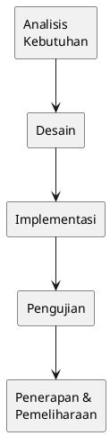
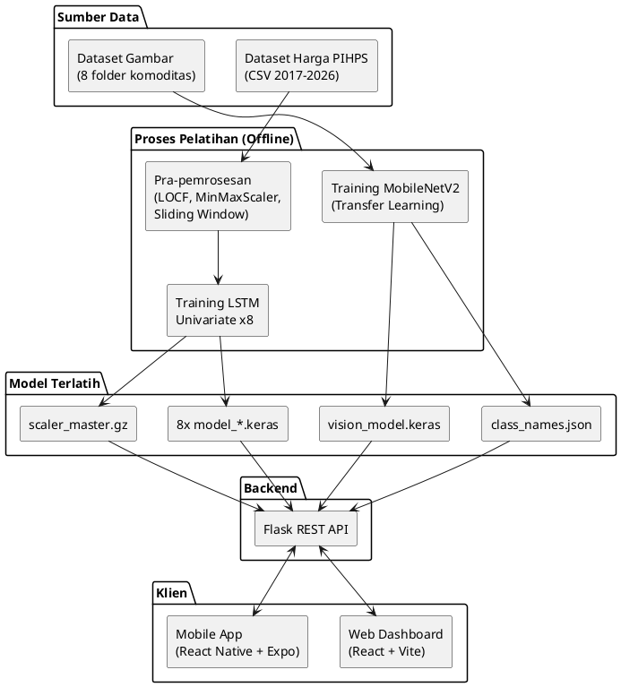
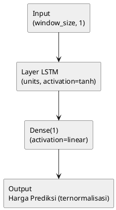
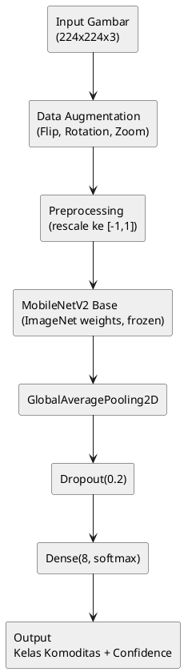
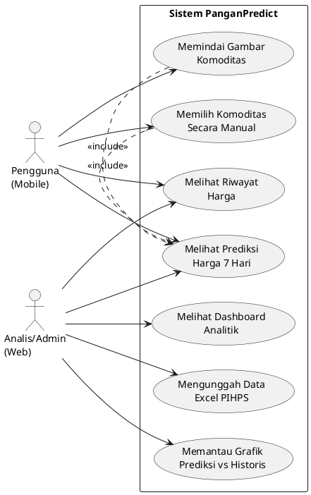
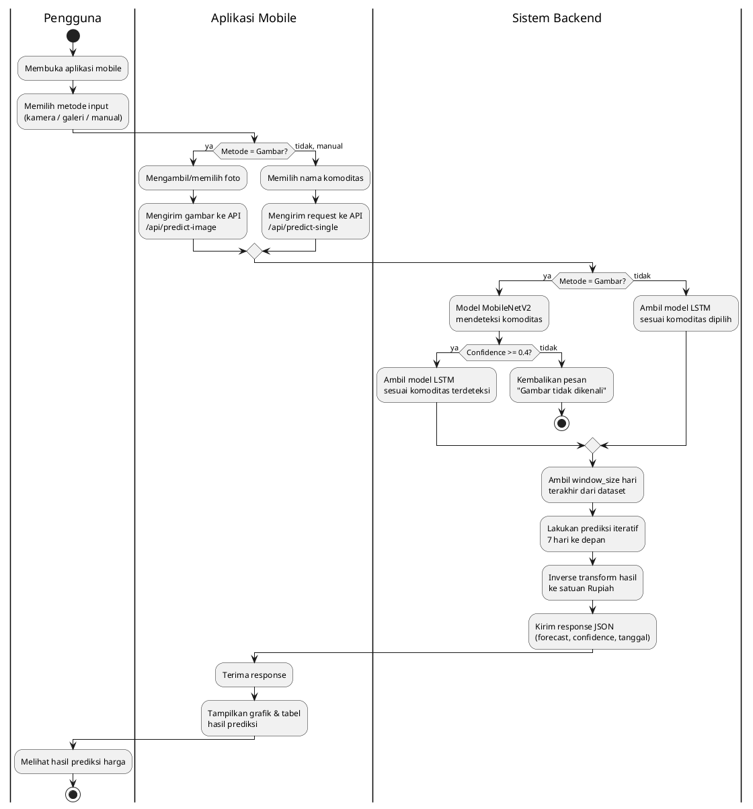
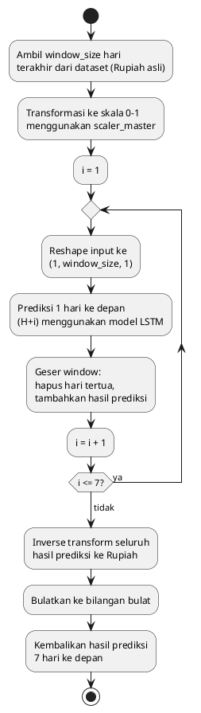
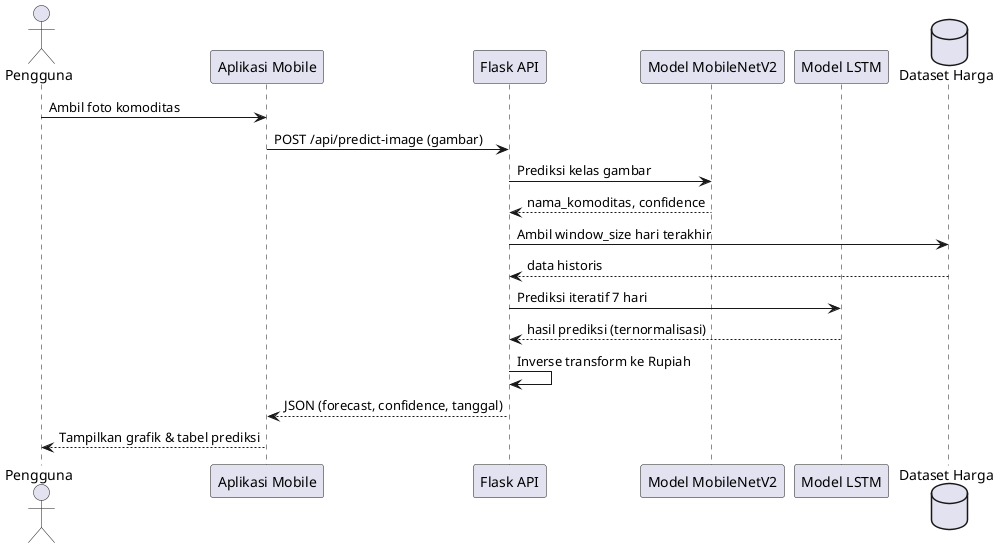
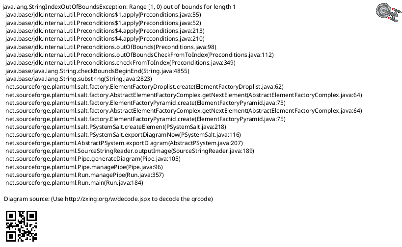

# Panduan Lengkap Penyusunan BAB III — KEGIATAN PELAKSANAAN
## Skripsi: Implementasi Model LSTM untuk Prediksi Harga Komoditas Pangan Berbasis Web di Provinsi Jawa Tengah (Sistem "PanganPredict")

> **Cara pakai dokumen ini:** Dokumen ini adalah panduan sekaligus bahan mentah untuk menulis narasi BAB III. Setiap sub-bab berisi (1) penjelasan apa yang harus ditulis, (2) poin-poin fakta teknis dari proyek yang harus dimasukkan, (3) tabel siap pakai (isi tinggal disesuaikan/diverifikasi), dan (4) kode PlantUML untuk diagram yang relevan. AI penulis tinggal mengubah poin-poin ini menjadi paragraf naratif akademik, **bukan** menyalin tabel/kode mentah ke dalam laporan.
>
> **Prinsip penting:** BAB III berisi **rancangan/desain** (apa yang direncanakan dan bagaimana cara mengujinya), BUKAN hasil eksperimen. Semua angka hasil (RMSE, MAE, MAPE aktual, akurasi model vision, hasil tuning terbaik) masuk ke **BAB IV — Analisis dan Pembahasan**. Tabel-tabel skenario di BAB III hanya berisi *rancangan konfigurasi yang akan diuji*, kolom hasil dikosongkan atau tidak dicantumkan.

---

## Konteks Proyek (Ringkasan untuk AI Penulis)

- **Nama sistem:** PanganPredict
- **Dua model AI:**
  1. **LSTM Univariate** (8 model terpisah, satu per komoditas) — meramalkan harga 7 hari ke depan.
  2. **MobileNetV2 (transfer learning)** — mendeteksi jenis komoditas dari foto.
- **8 komoditas:** Bawang Merah, Bawang Putih, Beras, Cabai Merah, Cabai Rawit, Daging Ayam, Minyak Goreng, Telur Ayam.
- **Sumber data harga:** PIHPS Nasional, wilayah Jawa Tengah, periode 2017–2026 (harian).
- **Sumber data gambar:** ±200+ gambar per komoditas, dikumpulkan dari internet dan foto manual.
- **Arsitektur sistem:** Flask (backend API) ↔ React 19 + Vite (web dashboard) & React Native + Expo (mobile app).
- **Metode pengembangan:** SDLC Waterfall.
- **Metode evaluasi:** MAE, RMSE, MAPE (untuk LSTM); Accuracy (untuk MobileNetV2).

---

## 3.1. Metode Pelaksanaan *(draft sudah ada — pertahankan, sinkronkan istilah)*

**Yang perlu ditulis:** Jelaskan bahwa pengembangan menggunakan SDLC Waterfall dengan lima tahap: Analisis Kebutuhan, Desain, Implementasi, Pengujian, Penerapan dan Pemeliharaan. Setiap tahap dijelaskan 1 paragraf singkat, dikaitkan langsung dengan aktivitas nyata di proyek ini (bukan definisi umum saja):

- **Analisis Kebutuhan:** pengumpulan data historis PIHPS, pengumpulan dataset gambar 8 komoditas, identifikasi kebutuhan fungsional/non-fungsional.
- **Desain:** perancangan arsitektur LSTM Univariate per komoditas, arsitektur MobileNetV2, skema API, UML, wireframe web dan mobile.
- **Implementasi:** pra-pemrosesan data (LOCF, normalisasi, sliding window), pelatihan model, pembangunan backend Flask, pembangunan frontend web dan mobile.
- **Pengujian:** evaluasi model dengan MAE/RMSE/MAPE dan accuracy, pengujian fungsional API dan antarmuka.
- **Penerapan dan Pemeliharaan:** deployment model ke server, pembaruan data berkala melalui fitur upload Excel PIHPS.

### PlantUML — Diagram Metode Waterfall



---

## 3.2. Gambaran Umum Sistem *(draft sudah ada — perkuat dengan alur dua model)*

**Yang perlu ditulis:** Jelaskan alur besar sistem end-to-end: data mentah (harga & gambar) → pra-pemrosesan → pelatihan dua model AI secara terpisah → penyimpanan model (`.keras`) dan scaler (`.gz`) → dimuat oleh Flask saat startup → Flask menyediakan REST API → dikonsumsi oleh Web (React) untuk kebutuhan dashboard analitik dan Mobile (React Native) untuk kebutuhan scan langsung oleh pengguna lapangan.

### PlantUML — Gambaran Umum Sistem (Component Diagram)



---

## 3.3. Analisis Kebutuhan

### 3.3.1. Analisis Kebutuhan Fungsional

**Yang perlu ditulis:** Narasikan poin-poin di bawah menjadi kalimat "Sistem harus mampu ...".

**Tabel 3.1 Kebutuhan Fungsional Sistem**

| No | Kebutuhan Fungsional |
|----|----|
| 1 | Sistem mampu mengumpulkan dan menyimpan data historis harga 8 komoditas pangan secara terstruktur dalam basis data harian. |
| 2 | Sistem mampu memperbarui dataset harga secara dinamis melalui unggahan file Excel resmi PIHPS. |
| 3 | Sistem mampu mendeteksi jenis komoditas pangan dari citra yang diambil melalui kamera atau galeri pengguna. |
| 4 | Sistem mampu menghasilkan prediksi harga untuk 7 hari ke depan bagi komoditas yang dipilih maupun yang terdeteksi otomatis. |
| 5 | Sistem mampu menampilkan riwayat harga historis berdasarkan filter komoditas, bulan, dan tahun. |
| 6 | Sistem mampu menyajikan hasil prediksi dalam bentuk visualisasi grafik dan tabel pada antarmuka web. |
| 7 | Sistem mampu menyediakan fitur pemindaian kamera dan pemilihan komoditas manual pada aplikasi mobile. |
| 8 | Sistem mampu memberikan API yang dapat diakses oleh lebih dari satu klien (web dan mobile) secara bersamaan. |

### 3.3.2. Analisis Kebutuhan Non-Fungsional

**Tabel 3.2 Kebutuhan Perangkat Keras**

| No | Perangkat | Spesifikasi Minimum |
|----|----|----|
| 1 | Laptop/Komputer (Training & Server) | Processor setara Intel Core i5, RAM 16 GB, penyimpanan SSD 20 GB, (disarankan GPU untuk mempercepat pelatihan) |
| 2 | Smartphone (Klien Mobile) | Android/iOS dengan kamera, minimum RAM 3 GB |

**Tabel 3.3 Kebutuhan Perangkat Lunak**

| No | Kategori | Perangkat Lunak |
|----|----|----|
| 1 | Bahasa Pemrograman | Python 3.x, JavaScript (ES2020+) |
| 2 | Framework Backend | Flask, Flask-CORS |
| 3 | Library Machine Learning | TensorFlow/Keras, scikit-learn, NumPy, Pandas, joblib |
| 4 | Framework Frontend Web | React 19, Vite 7, Tailwind CSS 4, React Router v7, Recharts |
| 5 | Framework Mobile | React Native 0.81, Expo 54, Expo Camera, Expo Image Picker |
| 6 | Tools Pengembangan | Visual Studio Code, Postman/Insomnia, Git |
| 7 | Sumber Data | Portal PIHPS Nasional (data harga), koleksi gambar internet & manual |

---

## 3.4. Perancangan Data

### 3.4.1. Sumber dan Struktur Data

**Yang perlu ditulis:** Jelaskan dua jenis dataset:

1. **Dataset harga (time series):** dari PIHPS Nasional, wilayah Jawa Tengah, periode 2017–2026, format asli Excel (tanggal `DD/MM/YYYY`, harga berformat koma sebagai pemisah ribuan), setelah digabung dan diisi LOCF menjadi ±3.400+ baris data harian kontinu dengan 8 kolom komoditas.
2. **Dataset gambar:** 8 folder (satu per komoditas), masing-masing berisi ±200+ gambar `.jpg/.jpeg/.png` dengan resolusi beragam.

**Tabel 3.4 Struktur Dataset Harga (Contoh)**

| tanggal | bawang_merah | bawang_putih | beras | cabai_merah | cabai_rawit | daging_ayam | minyak_goreng | telur_ayam |
|---|---|---|---|---|---|---|---|---|
| 2017-01-01 | 32000 | 28000 | 10500 | 35000 | 42000 | 33000 | 12500 | 21000 |
| 2017-01-02 | 32500 | 28000 | 10500 | 34500 | 41000 | 33200 | 12500 | 21200 |
| ... | ... | ... | ... | ... | ... | ... | ... | ... |

*(Catatan: isi nilai contoh di atas hanya ilustrasi format tabel; gunakan cuplikan data asli dari `dataset_harga_komoditas_2017_2026.csv` saat menulis laporan final.)*

**Tabel 3.5 Struktur Dataset Gambar**

| No | Nama Kelas (Folder) | Jumlah Gambar (±) | Format |
|----|----|----|----|
| 1 | bawang_merah | 200+ | jpg, jpeg, png |
| 2 | bawang_putih | 200+ | jpg, jpeg, png |
| 3 | beras | 210 | jpg, jpeg, png |
| 4 | cabai_merah | 200+ | jpg, jpeg, png |
| 5 | cabai_rawit | 200+ | jpg, jpeg, png |
| 6 | daging_ayam | 200+ | jpg, jpeg, png |
| 7 | minyak_goreng | 200+ | jpg, jpeg, png |
| 8 | telur_ayam | 200+ | jpg, jpeg, png |

### 3.4.2. Pra-pemrosesan Data Harga

**Yang perlu ditulis, urut sesuai pipeline nyata di `pre-processing.py`:**

1. **Konversi tipe data** — kolom tanggal dikonversi ke `datetime` (`%d/%m/%Y`), kolom harga dibersihkan dari koma pemisah ribuan lalu dikonversi ke `float`.
2. **LOCF (Last Observation Carried Forward)** — tanggal dijadikan indeks, dibuat `date_range` harian penuh, nilai kosong pada akhir pekan/hari libur PIHPS diisi menggunakan `ffill()` sehingga deret waktu menjadi kontinu tanpa celah.
3. **Normalisasi Min-Max** — menggunakan `MinMaxScaler(feature_range=(0,1))`, di-*fit* secara global pada seluruh 8 kolom harga sekaligus (satu scaler untuk semua komoditas) agar skala antar komoditas konsisten, kemudian disimpan sebagai `scaler_master.gz`.

**Tabel 3.6 Rancangan Tahapan Pra-pemrosesan Data Harga**

| Tahap | Proses | Tools/Fungsi |
|---|---|---|
| 1 | Parsing tanggal & pembersihan format harga | `pandas.to_datetime`, string cleaning |
| 2 | Pengisian tanggal kosong (LOCF) | `date_range` + `ffill()` |
| 3 | Normalisasi | `MinMaxScaler(feature_range=(0,1))` |
| 4 | Penyimpanan scaler | `joblib.dump()` → `scaler_master.gz` |

### 3.4.3. Pra-pemrosesan Data Gambar

**Yang perlu ditulis:** Semua gambar diseragamkan ke ukuran 224×224 piksel (sesuai kebutuhan input MobileNetV2), lalu dilakukan augmentasi data secara *on-the-fly* untuk memperkaya variasi data latih dan mengurangi risiko *overfitting*.

**Tabel 3.7 Rancangan Augmentasi Data Gambar**

| No | Teknik Augmentasi | Parameter |
|----|----|----|
| 1 | RandomFlip | horizontal |
| 2 | RandomRotation | ±0.2 (±20°) |
| 3 | RandomZoom | ±0.2 (±20%) |
| 4 | Preprocessing MobileNetV2 | rescale piksel ke rentang [-1, 1] |

### 3.4.4. Metode Sliding Window

**Yang perlu ditulis:** Jelaskan konsep sliding window untuk mengubah deret waktu menjadi pasangan data supervised (X, Y): X adalah sekuens harga sepanjang `window_size` hari berturut-turut, Y adalah harga satu hari berikutnya. Window yang diuji: **7, 14, dan 30 hari**.

### PlantUML — Ilustrasi Sliding Window (contoh window_size = 7)

```plantuml
@startuml
skinparam backgroundColor #FFFFFF

salt
{
  {T
    + Hari ke- | 1 | 2 | 3 | 4 | 5 | 6 | 7 | 8 (Target)
    + Data ke-1 (X)  | . | . | . | . | . | . | . | -> **Y1**
    + Data ke-2 (X)  |   | . | . | . | . | . | . | . | -> **Y2**
  }
}
@enduml
```



### 3.4.5. Pembagian Data (Sequential Holdout / Time-Series Split)

**Yang perlu ditulis:** Karena data bersifat deret waktu, pembagian data latih dan uji dilakukan **secara kronologis** (bukan acak) agar urutan temporal terjaga dan tidak terjadi kebocoran data (*data leakage*) dari masa depan ke masa lalu.

**Tabel 3.8 Rancangan Skenario Rasio Pembagian Data**

| Skenario | Data Latih | Data Uji |
|---|---|---|
| 1 | 70% | 30% |
| 2 | 80% | 20% |
| 3 | 90% | 10% |

---

## 3.5. Perancangan Arsitektur Model

### 3.5.1. Arsitektur Model LSTM Univariate

**Yang perlu ditulis:** Jelaskan pendekatan *univariate* — setiap komoditas dimodelkan secara independen dengan arsitektur dasar yang sama, namun hyperparameter optimalnya dicari terpisah melalui proses tuning (dijelaskan pada 3.5.3). Arsitektur dasar:

```
Input (window_size, 1) → LSTM(units, activation='tanh') → Dense(1, linear)
```

**Tabel 3.9 Rancangan Arsitektur dan Hyperparameter Dasar Model LSTM**

| Komponen | Konfigurasi |
|---|---|
| Layer | 1× LSTM (single layer, `return_sequences=False`) + 1× Dense(1) |
| Fungsi Aktivasi LSTM | tanh |
| Fungsi Aktivasi Output | linear (regresi) |
| Optimizer | Adam |
| Fungsi Kerugian (Loss) | Mean Squared Error (MSE) |
| Variasi Window Size yang diuji | 7, 14, 30 hari |
| Variasi Jumlah Unit LSTM yang diuji | 32, 64, 128 |

### PlantUML — Arsitektur Model LSTM Univariate



### 3.5.2. Arsitektur Model MobileNetV2 (Transfer Learning)

**Yang perlu ditulis:** Jelaskan alasan pemilihan MobileNetV2 (ringan, cocok untuk aplikasi mobile, sudah dilatih pada ImageNet), serta strategi *transfer learning* dengan membekukan (*freeze*) bobot base model dan hanya melatih layer klasifikasi tambahan.

**Tabel 3.10 Rancangan Arsitektur Model MobileNetV2**

| Layer/Tahap | Keterangan |
|---|---|
| Input | (224, 224, 3) |
| Data Augmentation | RandomFlip, RandomRotation(0.2), RandomZoom(0.2) |
| Preprocessing | Rescale ke [-1, 1] sesuai standar MobileNetV2 |
| Base Model | MobileNetV2 (bobot ImageNet, dibekukan/*frozen*) |
| Pooling | GlobalAveragePooling2D() |
| Regularisasi | Dropout(0.2) |
| Output Layer | Dense(8, activation='softmax') |

**Tabel 3.11 Rancangan Parameter Pelatihan Model MobileNetV2**

| Parameter | Nilai |
|---|---|
| Optimizer | Adam (learning rate = 0.001) |
| Loss Function | SparseCategoricalCrossentropy |
| Metrik Evaluasi | Accuracy |
| Epoch Maksimum | 15 |
| Batch Size | 32 |
| Rasio Split Train/Validasi | 80/20 |
| Early Stopping | monitor=`val_loss`, patience=3 |
| Ambang Batas Keyakinan (Confidence Threshold) | < 0.4 → gambar ditolak/tidak dikenali |

### PlantUML — Arsitektur Model MobileNetV2



### 3.5.3. Rancangan Skenario Eksperimen

**Yang perlu ditulis:** Ada dua tahap eksperimen yang **direncanakan** di sini (hasilnya dibahas di BAB IV):

**a) Eksperimen 6 Skenario (Konfigurasi Seragam)** — seluruh 8 komoditas diuji dengan kombinasi window size dan unit LSTM yang **sama** untuk perbandingan yang adil antar konfigurasi.

**Tabel 3.12 Rancangan 6 Skenario Eksperimen (Konfigurasi Seragam)**

| Skenario | Window Size | LSTM Units | Epoch Maks | Batch Size | Early Stopping (patience) | Split Data |
|---|---|---|---|---|---|---|
| 1 | 7 | 32 | 1000 | 32 | 50 | 80/20 |
| 2 | 7 | 64 | 1000 | 32 | 50 | 80/20 |
| 3 | 14 | 32 | 1000 | 32 | 50 | 80/20 |
| 4 | 14 | 64 | 1000 | 32 | 50 | 80/20 |
| 5 | 30 | 32 | 1000 | 32 | 50 | 80/20 |
| 6 | 30 | 64 | 1000 | 32 | 50 | 80/20 |

**b) Sequential Holdout Tuning (Pencarian Hyperparameter Per Komoditas)** — dilakukan grid search individual per komoditas untuk menentukan konfigurasi produksi terbaik.

**Tabel 3.13 Rancangan Grid Search Sequential Holdout Tuning**

| Parameter | Nilai yang Diuji |
|---|---|
| Rasio Split | 0.7, 0.8, 0.9 |
| Window Size | 7, 14, 30 hari |
| Jumlah Unit LSTM | 32, 64, 128 |
| Total Kombinasi per Komoditas | 3 × 3 × 3 = 27 |
| Total Kombinasi Keseluruhan (8 komoditas) | 27 × 8 = 216 |
| Epoch Maksimum | 100 |
| Batch Size | 16 |
| Early Stopping | monitor=`val_loss`, patience=10, restore_best_weights=True |
| Kriteria Pemilihan Terbaik | MAPE terendah |

---

## 3.6. Perancangan Sistem (UML dan Flowchart)

### 3.6.1. Use Case Diagram

**Yang perlu ditulis:** Jelaskan dua aktor utama: **Pengguna** (petani/konsumen, mengakses via mobile) dan **Analis/Admin** (mengakses via web dashboard). Uraikan use case masing-masing sesuai diagram.

### PlantUML — Use Case Diagram



### 3.6.2. Activity Diagram

**Yang perlu ditulis:** Uraikan alur aktivitas pengguna mobile dari membuka aplikasi hingga menerima hasil prediksi, melibatkan tiga swimlane: Pengguna, Aplikasi Mobile, dan Sistem Backend.

### PlantUML — Activity Diagram (Alur Scan dan Prediksi)



### 3.6.3. Flowchart Proses Pelatihan Model

**Yang perlu ditulis:** Jelaskan tahapan pelatihan model dari persiapan data hingga model siap dipakai, berlaku untuk kedua jenis model (dijelaskan generik, dengan catatan perbedaan pada tahap "pembuatan model").

### PlantUML — Flowchart Pelatihan Model

```plantuml
@startuml
skinparam backgroundColor #FFFFFF
start
:Persiapan data\n(pra-pemrosesan);
:Membuat arsitektur model\n(LSTM / MobileNetV2);
:Melatih model\n(training);
:Menampilkan hasil evaluasi\n(loss, MAE/RMSE/MAPE atau accuracy);
if (Akurasi/error sudah\nmemenuhi target?) then (belum)
  :Menyesuaikan hyperparameter;
  backward:Kembali ke tahap pelatihan;
else (sudah)
  :Menyimpan model final\n(.keras) dan scaler (.gz);
  :Model siap digunakan\nuntuk prediksi;
endif
stop
@enduml
```

### 3.6.4. Flowchart Mekanisme Prediksi Iteratif (Autoregressive 7 Hari)

**Yang perlu ditulis:** Ini adalah bagian **unik dan penting** dari sistem Anda — jelaskan bagaimana prediksi 7 hari ke depan dilakukan secara *iteratif* (bukan langsung 7 output sekaligus), karena model hanya dilatih untuk memprediksi 1 langkah ke depan.

### PlantUML — Flowchart Mekanisme Prediksi Iteratif



### 3.6.5. Sequence Diagram Interaksi API

**Yang perlu ditulis (opsional, memperkuat penjelasan arsitektur backend):** Menjelaskan interaksi antara klien (web/mobile), Flask API, dan model saat permintaan prediksi diproses.

### PlantUML — Sequence Diagram Prediksi via Gambar



---

## 3.7. Perancangan Arsitektur Backend (API)

### 3.7.1. Rancangan Endpoint API Flask

**Yang perlu ditulis:** Jelaskan tiap endpoint, method HTTP, dan fungsinya, mengacu ke tabel berikut. Jelaskan juga proses *startup* backend: memuat dataset, memuat 8 model LSTM, memuat scaler global, memuat model vision dan daftar kelas.

**Tabel 3.14 Rancangan Endpoint API**

| Endpoint | Method | Fungsi |
|---|---|---|
| `/api/latest-data` | GET | Mengambil 30 hari data harga terakhir (Rupiah asli) beserta tanggalnya |
| `/api/predict` | POST | Memprediksi harga 7 hari ke depan untuk seluruh 8 komoditas sekaligus |
| `/api/predict-image` | POST | Menerima gambar → deteksi komoditas via MobileNetV2 → prediksi LSTM 7 hari |
| `/api/predict-single/<komoditas>` | GET | Memprediksi 7 hari untuk satu komoditas yang dipilih manual |
| `/api/history` | GET | Mengambil data historis berdasarkan filter komoditas, bulan, dan tahun |
| `/api/upload-excel` | POST | Menerima file Excel PIHPS, melakukan parsing, penggabungan, dan LOCF ulang, lalu menyimpan permanen |

### 3.7.2. Rancangan Format Respons API

**Yang perlu ditulis:** Tampilkan contoh struktur JSON respons `/api/predict-image` sebagai ilustrasi kontrak data antara backend dan klien:

```json
{
  "detected_commodity": "beras",
  "display_name": "Beras",
  "confidence": 0.9523,
  "forecast": [15000, 15100, 15050, 15200, 15150, 15300, 15250],
  "last_price": 14800,
  "last_date": "24 Jul 2026",
  "next_dates": ["25 Jul 2026", "26 Jul 2026", "..."],
  "historical_prices": ["... 30 harga terakhir ..."],
  "historical_dates": ["... 30 tanggal terakhir ..."]
}
```

---

## 3.8. Perancangan Antarmuka dan Interaksi Aplikasi

### 3.8.1. Rancangan Antarmuka Website (Dashboard)

**Yang perlu ditulis:** Uraikan tiga halaman utama web (`Home`, `Dashboard`, `About`) dan komponen kunci di Dashboard: kartu 8 komoditas, grafik dual-area (30 hari historis + 7 hari prediksi), tabel prediksi dengan indikator naik/turun harga, serta tombol unggah Excel. Sertakan mockup/wireframe sederhana (dapat berupa gambar hasil desain Figma/drawio, karena PlantUML kurang ideal untuk wireframe visual — namun berikut alternatif sederhana bila diperlukan).

**Tabel 3.15 Ringkasan Komponen Antarmuka Web**

| Halaman | Komponen Utama | Fungsi |
|---|---|---|
| Home | Hero section | Landing page pengenalan sistem |
| Dashboard | Kartu 8 komoditas | Menampilkan harga terkini tiap komoditas |
| Dashboard | Grafik dual-area (Recharts) | Visualisasi 30 hari historis + 7 hari prediksi |
| Dashboard | Tabel prediksi 7 hari | Menampilkan tanggal, harga prediksi, dan delta perubahan |
| Dashboard | Tombol unggah Excel | Memperbarui dataset harga dari file PIHPS |
| About | Informasi teknis | Penjelasan arsitektur model AI kepada pengguna |

### 3.8.2. Rancangan Antarmuka Aplikasi Mobile

**Yang perlu ditulis:** Uraikan dua layar utama (`Home/Scan` dan `History`) beserta fitur kamera, galeri, pemilihan manual, dan grafik gabungan historis-prediksi.

**Tabel 3.16 Ringkasan Komponen Antarmuka Mobile**

| Layar | Komponen Utama | Fungsi |
|---|---|---|
| Home (Scan) | Kamera & Galeri | Mengambil/memilih foto komoditas untuk dideteksi |
| Home (Scan) | Modal pilihan manual | Memilih komoditas tanpa foto |
| Home (Scan) | Kartu hasil prediksi | Nama komoditas, confidence, harga terakhir |
| Home (Scan) | Grafik LineChart | 30 hari historis (hijau) + 7 hari prediksi (biru) |
| History | Filter (komoditas/bulan/tahun) | Menyaring data riwayat harga |
| History | Grafik & Statistik ringkas | Harga terendah, tertinggi, rata-rata |

### PlantUML — Wireframe Sederhana Halaman Dashboard (Salt)



---

## Ringkasan Struktur BAB III

```
BAB III KEGIATAN PELAKSANAAN
3.1  Metode Pelaksanaan
3.2  Gambaran Umum Sistem
3.3  Analisis Kebutuhan
     3.3.1 Analisis Kebutuhan Fungsional
     3.3.2 Analisis Kebutuhan Non-Fungsional
3.4  Perancangan Data
     3.4.1 Sumber dan Struktur Data
     3.4.2 Pra-pemrosesan Data Harga
     3.4.3 Pra-pemrosesan Data Gambar
     3.4.4 Metode Sliding Window
     3.4.5 Pembagian Data (Sequential Holdout)
3.5  Perancangan Arsitektur Model
     3.5.1 Arsitektur Model LSTM Univariate
     3.5.2 Arsitektur Model MobileNetV2
     3.5.3 Rancangan Skenario Eksperimen
3.6  Perancangan Sistem (UML dan Flowchart)
     3.6.1 Use Case Diagram
     3.6.2 Activity Diagram
     3.6.3 Flowchart Proses Pelatihan Model
     3.6.4 Flowchart Mekanisme Prediksi Iteratif
     3.6.5 Sequence Diagram Interaksi API
3.7  Perancangan Arsitektur Backend (API)
     3.7.1 Rancangan Endpoint API Flask
     3.7.2 Rancangan Format Respons API
3.8  Perancangan Antarmuka dan Interaksi Aplikasi
     3.8.1 Rancangan Antarmuka Website
     3.8.2 Rancangan Antarmuka Aplikasi Mobile
```

---

## Catatan Penting untuk AI Penulis

1. **Jangan mencantumkan hasil eksperimen aktual (angka RMSE/MAE/MAPE/accuracy final)** di BAB III — itu adalah isi BAB IV. Tabel 3.12 dan 3.13 di atas hanya *rancangan pengujian*, bukan hasil.
2. **Render semua kode PlantUML** menjadi gambar (misalnya via plantuml.com, ekstensi VS Code, atau library plantuml) sebelum dimasukkan ke dokumen Word/PDF akhir — jangan menyisipkan kode mentah ke laporan.
3. Setiap tabel di atas adalah **kerangka**; verifikasi ulang jumlah baris data, tanggal, dan nilai spesifik terhadap file dataset asli (`dataset_harga_komoditas_2017_2026.csv`, `semua_hasil_tuning.csv`, dll.) sebelum finalisasi.
4. Gaya penulisan mengikuti pola kedua contoh laporan referensi: paragraf naratif akademik, tabel dirujuk dengan format "Tabel X.Y", gambar/diagram dirujuk dengan format "Gambar X.Y", dan setiap tabel/gambar diberi penjelasan sebelum atau sesudahnya dalam teks.
5. Penomoran Tabel dan Gambar pada dokumen ini bersifat sementara (mengikuti urutan sub-bab); sesuaikan dengan sistem penomoran otomatis (Table of Figures/Tables) pada dokumen akhir.
